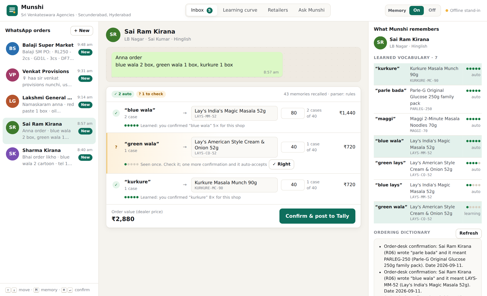
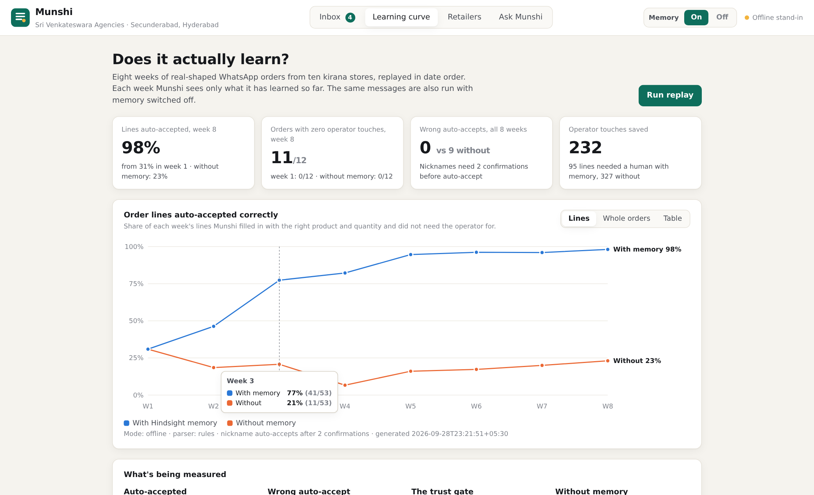
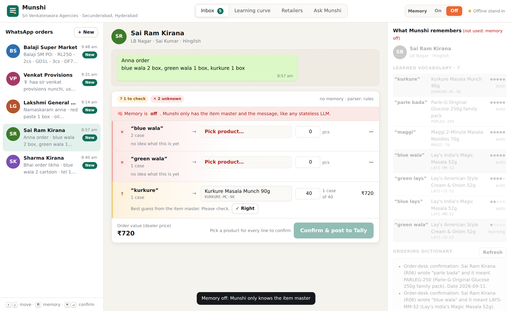
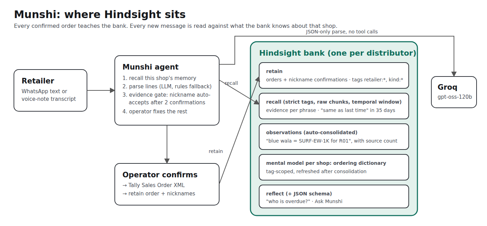

# Munshi: the WhatsApp order desk that learns every shop's language

> *munshi* (Hindi/Urdu): the clerk who keeps the ledger.

Kirana stores in Hyderabad don't send purchase orders. They send WhatsApp messages like this:

```
Bhai order likho
blue wala 2 cartoon
tel 1 cartoon
chota parle 1 cartoon
shaam tak chahiye
```

At the distributor, one order-desk veteran knows that for **Sharma Kirana**, "blue wala" means *Surf Excel Easy Wash 1kg*, "tel" means *Freedom sunflower oil 1L pouches*, and "cartoon" means a case of 12. For **Sai Ram Kirana**, three kilometres away, "blue wala" means *Lay's Magic Masala*. When that person is on leave, orders go wrong.

**Munshi turns those messages into Tally sales orders, and learns each shop's vocabulary from the operator's corrections.** Its memory is [Hindsight](https://github.com/vectorize-io/hindsight). There are no alias tables in this codebase. Everything Munshi knows about a shop, it learned.



## The result, measured

Eight weeks of orders (96 messages, 417 order lines, 10 shops) are replayed in date order. Each week Munshi sees only what it has learned so far. The same messages are also run with memory switched off: same parser, same item master, same safety gate.

| | Week 1 | Week 4 | Week 8 | Wrong auto-accepts (8 weeks) |
|---|---|---|---|---|
| **With Hindsight memory** | 31% of lines auto-accepted | 82% | **98%** | **0** |
| Without memory | 31% | 7% | 23% | 9 |



These numbers come from the bundled offline run (`docs/learning_curve.sample.json`, which uses the keyword stand-in for memory so it can run anywhere). Run `python scripts/replay.py` with your Hindsight key to produce the same curve against a live Hindsight bank. The UI shows whichever run is newest, and labels which one it is.

**Why "wrong auto-accepts" matters more than the rate.** One wrong order to a kirana store costs more than ten slow ones. Without memory, the agent auto-accepted 9 wrong lines, all on "same as last time, plus … extra" orders: it posted only the extra line, because the usual order lives in the shop's history. Munshi only auto-accepts a shop's nickname after the operator has confirmed it **twice** (the *evidence gate*), so it never auto-accepted a wrong line.

## Before / after on one message

| Sai Ram Kirana: "blue wala 2 box, green wala 1 box, kurkure 1 box" | Memory off | Memory on |
|---|---|---|
| blue wala | ✕ unknown | ✓ Lay's Magic Masala 52g, 2 cases (confirmed 5× for this shop) |
| green wala | ✕ unknown | ? Lay's Cream & Onion: *seen once, check it* |
| kurkure | ? best guess | ✓ Kurkure Masala Munch 90g (confirmed 8×) |



"Same as last time" and "usual list pampandi" are rebuilt from the shop's most recent confirmed order, recalled from Hindsight inside a 35-day time window. With memory off, they are simply unknown.

## How Hindsight is used

| What you see | Hindsight feature | Code |
|---|---|---|
| Every confirmed order teaches Munshi: one fact per order, plus one *"Sharma Kirana (R01) wrote "blue wala" and it meant SURF-EW-1K"* fact per nickname line. Operator corrections are retained too | **retain** (batched), tags `retailer:R01`, `kind:order` / `kind:alias` / `kind:correction`, real timestamps | `agent.py` `confirm_items` |
| A message is read against **that shop's** memory only. "blue wala" means different products for different shops, with no leakage | **recall** with `tags_match="all_strict"` / `"any_strict"` | `agent.py` `process` |
| The evidence gate counts distinct confirmations from the **raw retained text**, not from paraphrased facts | recall with `include_chunks=True`; confirmations deduplicated by `document_id` | `parser.py` `alias_evidence` |
| "Same as last time" → the last confirmed order | recall with `temporal_window` (last 35 days) + `query_timestamp` | `agent.py` `process` |
| A per-shop **ordering dictionary** that rewrites itself as orders come in | **mental model** per retailer, tag-scoped, `refresh_after_consolidation=True` | `memory.py` `ensure_dictionary` |
| "blue wala = SURF-EW-1K for R01, confirmed 3 times" as one belief, not three loose facts | **observations** (automatic consolidation, with a custom `observations_mission`) | `memory.py` `setup` |
| *Ask Munshi*: "Who is overdue for their usual order?" returns structured insight cards | **reflect** with `response_schema` | `agent.py` `insights` |
| The bank is told what to extract: phrases in quotes, SKU codes and retailer ids verbatim | bank `retain_mission`, `reflect_mission` | `memory.py` |



## Design decisions

- **The LLM reads; evidence decides.** The LLM (Groq `gpt-oss-120b`) only splits a messy message into *(phrase, qty, unit)* lines. Whether a line is safe to post is decided in plain Python from evidence: confirmations recalled from Hindsight, or an unambiguous item-master match. An LLM guess never auto-accepts.
- **No function calling.** Retrieval and retention are deterministic orchestration around one JSON-only LLM call. If the model returns bad JSON or the provider errors, Munshi falls back to a rule parser instead of failing the order (`agent.py` `_raw_lines`).
- **Tally stays the system of record.** Every confirmed order produces a Tally-importable Sales Order voucher (`tally.py`). Munshi does not post into Tally directly, because every on-premise Tally is configured differently.
- **Operational state is not memory.** Today's inbox is a JSON file. Everything *learned* lives in Hindsight.

## Run it

Needs Python 3.10+.

```bash
git clone https://github.com/saibharath954/pakka munshi && cd munshi
python -m venv .venv && source .venv/bin/activate      # Windows: .venv\Scripts\activate
pip install -r requirements.txt
cp .env.example .env
```

In `.env`, set:

- `HINDSIGHT_API_KEY`: from [Hindsight Cloud](https://ui.hindsight.vectorize.io) (add promo credits under Billing). Self-hosting? Run the [Docker image](https://github.com/vectorize-io/hindsight#1-start-a-server) and set `HINDSIGHT_URL=http://localhost:8888`.
- `LLM_API_KEY`: a [Groq](https://console.groq.com) key. Any OpenAI-compatible endpoint works via `LLM_BASE_URL` and `LLM_MODEL`. With no key, Munshi uses the rule parser.

```bash
python scripts/smoke.py        # checks both keys
python scripts/replay.py       # teaches the bank 8 weeks of orders and measures the curve (several minutes)
uvicorn munshi.app:app         # http://localhost:8000
```

### Three-minute demo

1. **Inbox → Sai Ram Kirana.** "blue wala" resolves to Lay's, with evidence dots. Press **M** (or the *Memory* switch): everything turns red. Press **M** again.
2. **Sharma Kirana.** The same "blue wala" is Surf Excel here. Confirm with **⌘/Ctrl + ↵**: the card shows exactly which facts were retained to Hindsight, plus a Tally XML download.
3. **Venkat Provisions.** A voice-note transcript saying "usual list": rebuilt from last week's order.
4. **+ New**: type *"green wala 1 box"* for Sai Ram Kirana. It is seen once, so it goes to review. Confirm it, send it again, and it auto-accepts.
5. **Learning curve** tab: the chart above. **Ask Munshi**: *"What does blue wala mean for each shop?"*

### Offline mode and tests

`MUNSHI_OFFLINE=1` swaps Hindsight for an in-process keyword stand-in. It is for tests and UI work only, and the UI labels it.

```bash
pip install -r requirements-dev.txt
pytest -q          # 16 tests, including a wire-contract test of the Hindsight client
ruff check munshi tests scripts
```

## Project layout

```
munshi/
  agent.py      recall → parse → evidence gate → confirm → retain
  parser.py     rule parser, evidence counting from recalled memories, the gate
  memory.py     HindsightMemory (bank, recall, reflect, mental models) + LocalMemory stand-in
  evaluate.py   8-week replay with/without memory, metrics
  seed_data.py  10 Hyderabad kirana stores with their own vocabularies; deterministic order generator with gold labels
  catalog.py    item master (48 FMCG SKUs, case sizes, dealer prices)
  tally.py      Tally Sales Order XML
  app.py        FastAPI API; static/ is the UI (no build step)
scripts/        replay.py, smoke.py
tests/          parser, agent, API, Hindsight contract
```

## Data and honesty notes

- The retailers, messages and prices are synthetic. They are modelled on how Hyderabad FMCG distribution runs over WhatsApp: Hinglish, Telugu-English and Urdu-Hindi phrasing, "cartoon" and "peti" for cases, voice-note transcripts. Prices are rounded demo dealer prices.
- The evaluation's "operator" is simulated: it confirms the gold order, exactly as a human would in the UI.
- This is the order-desk half of the job. Stock checks, credit limits and WhatsApp Business API intake are the obvious next steps.

## Links

- Hindsight on GitHub: https://github.com/vectorize-io/hindsight
- Hindsight docs: https://hindsight.vectorize.io/
- What is agent memory: https://vectorize.io/what-is-agent-memory

MIT licensed.
