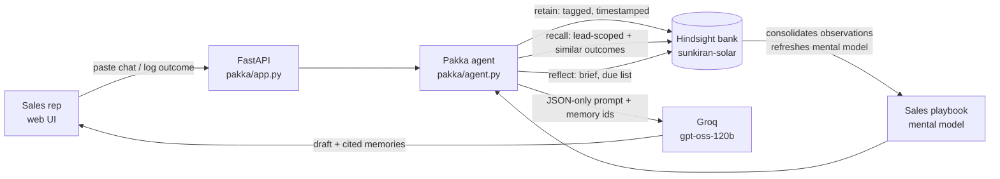

# Pakka: sales follow-ups that remember every lead and learn what closes

> *pakka* (Hindi/Telugu slang): confirmed, for sure. As in "deal pakka".

Indian small businesses sell over WhatsApp. A rooftop-solar installer in Hyderabad might have 3 reps, 150 open leads from IndiaMART and JustDial, and the entire sales history living in scattered chat threads. Who promised to call whom after Dasara? Which flat owner is blocked on their residents' association? Did the subsidy-proof message or the discount work better on independent-house owners? Nobody remembers, so every follow-up is generic ("special discount this week!"), and warm leads go cold.

**Pakka is a follow-up agent whose memory is [Hindsight](https://github.com/vectorize-io/hindsight).** Every conversation and every outcome is *retained*. Before each follow-up it *recalls* this lead's history plus what happened with similar leads. A Hindsight *mental model* keeps rewriting the team's playbook of what actually closes, as new outcomes come in.

<!-- TODO before submitting: add a screenshot from a live run as docs/ui.png and restore this line:  -->

## The before/after in one lead

Suresh Varma, an apartment owner in Nallagandla, asks on IndiaMART: *"What is price for 3kW? Is subsidy there for flats? Please send quotation fast, comparing 3 vendors."*

| | Without memory (stateless LLM) | With Hindsight memory |
|---|---|---|
| Sees | CRM row + his last message | + everything about Suresh, + outcomes of similar leads, + learned playbook |
| Drafts | Price per watt and a discount, sent now | No price before survey. RWA NOC template + offer to present at his society meeting. Group-housing subsidy for the common area |
| Why | Nothing to go on | Quoting first made Neha Kapoor ghost and stalled Rahul Mehta for 2 weeks. The RWA template got Priya Nair's society to approve in 3 weeks |

The draft cites the memory ids it relied on, and the UI shows those memories, so a rep can check *why* the agent chose this angle.

## How Hindsight is used

| Hindsight feature | Where in Pakka | Why it matters |
|---|---|---|
| **Bank** (`sunkiran-solar`) with `retain_mission` + `reflect_mission` | [`memory.py`](pakka/memory.py) `setup()` | One brain per company. The retain mission tells extraction to pull out objections, decision makers, and callback dates, and to resolve "after 2 weeks" into an absolute date |
| **retain** with tags `lead:*`, `segment:*`, `kind:interaction/outcome`, `approach:*`, `result:*` and real timestamps | [`agent.py`](pakka/agent.py) `log_interaction`, `log_outcome`, `replay` | Tags let one bank serve both *"everything about this lead"* and *"what worked across all apartment leads"* |
| **recall** with `tags_match="any_strict"` | `Pakka.draft` | Two recalls in parallel: this lead's memories (strictly scoped, no cross-lead leakage), and outcome memories from similar leads |
| **reflect** (lead-scoped) | `Pakka.brief` | A 120-word pre-call brief: who decides, objections, promises, what we tried |
| **reflect** + `response_schema` | `Pakka.due` | "Who did we promise to call, and when?" returned as structured JSON for the *Due now* panel |
| **Mental model** `sales-playbook`, `refresh_after_consolidation=True` | `memory.py` `setup()`, playbook panel | A standing answer to *"which approaches work for which segment and objection?"*. Hindsight rewrites it in the background whenever new outcomes consolidate into observations. Reading it is a DB read, not an LLM call |
| **Observations** (automatic consolidation) | on by default | Several apartment leads stalling on RWA approval become one evidence-backed belief instead of scattered facts |

What Pakka does **not** keep in Hindsight: the CRM row (name, phone, segment, status) lives in a small JSON store ([`crm.py`](pakka/crm.py)). Anything *learned* lives in Hindsight.



### Design decisions worth knowing

- **No function calling.** The orchestration (what to recall, when to retain) is plain Python. The LLM gets one prompt and returns one JSON object. On Groq-hosted open models this is far more reliable than tool loops, and a bad parse is retried. See [`llm.py`](pakka/llm.py).
- **The "without memory" baseline is fair.** It still sees the CRM row and the message it is replying to, which is what a normal WhatsApp bot sees. The only difference is Hindsight.
- **History is dated relative to today**, so the 8-week seed story always looks current, and temporal recall ("call me after 2 weeks") behaves correctly.

## Run it

Requires Python 3.10+.

```bash
git clone <this repo> && cd pakka
python -m venv .venv && source .venv/bin/activate      # Windows: .venv\Scripts\activate
pip install -r requirements.txt
cp .env.example .env    # then fill in the two keys below
```

1. **Hindsight**: easiest is [Hindsight Cloud](https://ui.hindsight.vectorize.io). Create an account, add credits in Billing, and create an API key. Put it in `HINDSIGHT_API_KEY`. Self-hosting instead? `docker compose up hindsight` (read the note in `docker-compose.yml`: Groq's *free* tier is too small for Hindsight's own extraction calls) and set `HINDSIGHT_URL=http://localhost:8888`.
2. **LLM for drafting**: a [Groq](https://console.groq.com) key in `LLM_API_KEY`. Any OpenAI-compatible endpoint works via `LLM_BASE_URL` / `LLM_MODEL`.

```bash
python scripts/smoke.py                 # checks both keys end to end
python scripts/seed.py --reset          # loads 8 weeks of sales history (40 events) into Hindsight
uvicorn pakka.app:app --reload          # open http://localhost:8000
```

Seeding takes a minute or two (Hindsight extracts facts from every event). The playbook mental model fills in shortly after, once consolidation runs. Click **Refresh** on the playbook panel if you're impatient.

### Demo flow (3 minutes)

1. **Learning curve.** *History → Reset → load weeks 1–2 only*. The playbook is thin: a couple of failed discounts. Then *History → Load the remaining weeks*. The playbook now has segment-by-segment rules with evidence.
2. **Before/after.** Select **Suresh Varma** → *Draft: without vs with memory*. Left: price + discount. Right: RWA template, no premature quote, cites Neha, Rahul and Priya.
3. **Language + family.** Select **Padma Reddy** → draft with memory. It comes out in Telugu, suggests looping in her daughter, and leads with subsidy proof. That's what worked for Lakshmi Devi, who referred her.
4. **Promises.** *Due now → Check memory*: Mohammed Irfan's "call after 6pm today" and Rahul Mehta's post-vote Monday follow-up. Kiran Kumar was lost because nobody called when promised.
5. **Teach it live.** On Suresh, *Retain an outcome*: `rwa_noc_template_plus_society_presentation` / `replied`. The playbook refresh is queued. Ask the memory: *"Why do apartment leads go cold?"*

### Offline mode and tests

`PAKKA_OFFLINE=1` swaps Hindsight for a keyword-matching stand-in and the LLM for a template. It is only for tests and UI work. It does **not** show what Hindsight does.

```bash
pip install -r requirements-dev.txt
pytest -q
```

The suite includes a contract test that drives the real `hindsight-client` against a stub HTTP server. It checks that tags, strict tag matching, timestamps, the mental-model trigger and the reflect response schema go over the wire as intended.

## Project layout

```
pakka/
  agent.py       orchestration: retain / recall / reflect, prompt assembly, history replay
  memory.py      HindsightMemory (real) + LocalMemory (tests)
  llm.py         JSON-only OpenAI-compatible client (Groq default) with retries
  crm.py         plain lead rows (not knowledge)
  seed_data.py   8 weeks of realistic sales history for a Hyderabad solar installer
  app.py         FastAPI + static UI
  static/        index.html, app.js, style.css (no build step)
scripts/         seed.py, smoke.py
tests/           unit + API + Hindsight contract tests
```

## Data

All leads, phone numbers and conversations are synthetic. They are modelled on how Hyderabad rooftop-solar sales actually run: IndiaMART/JustDial leads, the PM Surya Ghar subsidy, RWA approvals for apartments, and TGSPDCL net metering. Phone numbers are masked (`xxxxx`).

## Links

- Hindsight on GitHub: https://github.com/vectorize-io/hindsight
- Hindsight docs: https://hindsight.vectorize.io/
- What is agent memory: https://vectorize.io/what-is-agent-memory

MIT licensed.
