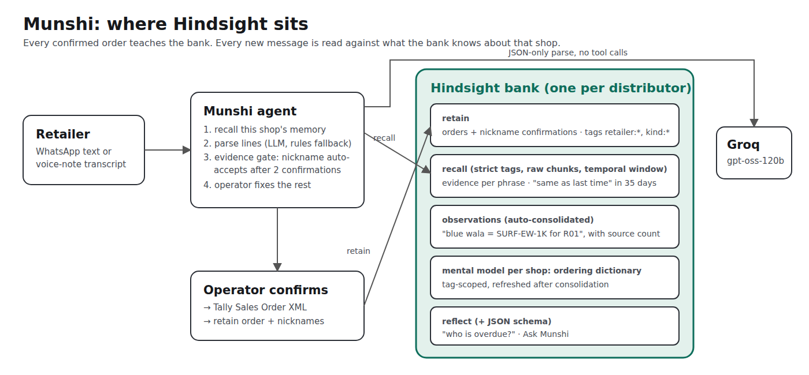
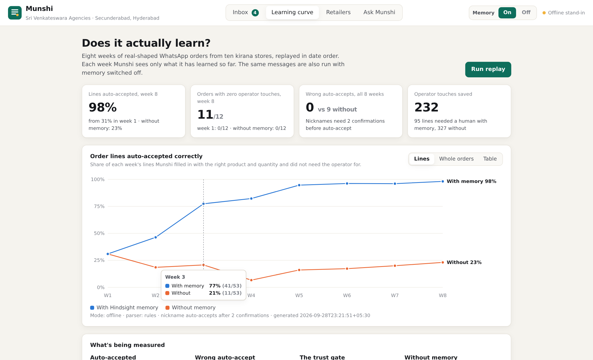
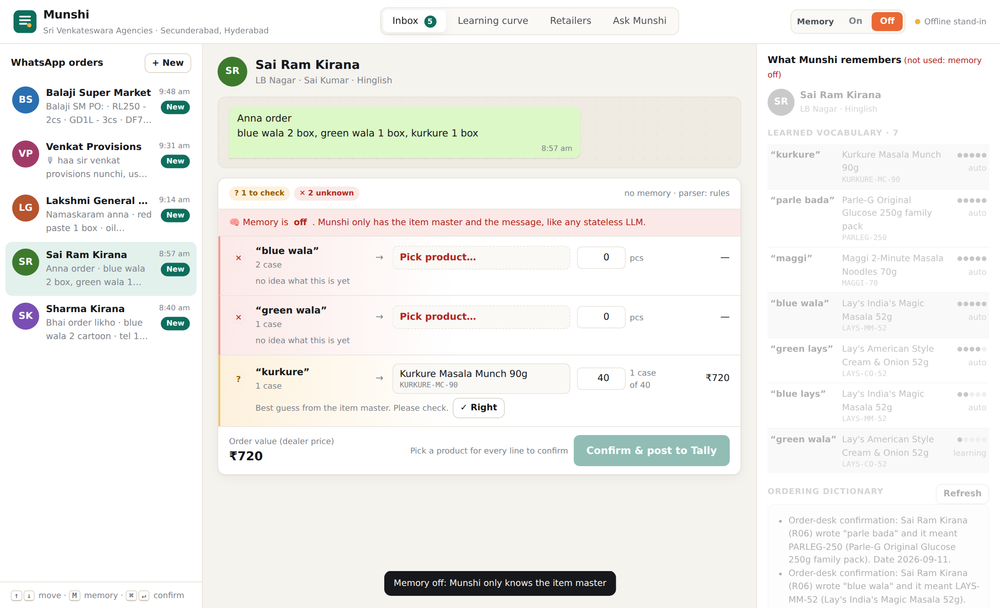

# "Blue wala" means Surf to one shop, chips to another

Sharma Kirana in Ameerpet sends *"blue wala 2 cartoon"*. That means two cases of Surf Excel Easy Wash. Sai Ram Kirana in LB Nagar sends *"blue wala 2 box"*. That means two cases of Lay's Magic Masala. Same two words, different products, and nothing in either message tells you which.

At a Hyderabad FMCG distributor, the only thing that resolves this is a person: the order-desk clerk who has read every WhatsApp message from every shop for years. I built **Munshi** to be that clerk's memory. This post is about how I did it with [Hindsight, an open-source agent memory system](https://github.com/vectorize-io/hindsight), and how I measured whether it actually learns instead of just asserting that it does.

## The problem is memory, not language

Small distributors in India take most retail orders over WhatsApp. The messages look like this:

```
Bhai order likho
blue wala 2 cartoon
tel 1 cartoon
chota parle 1 cartoon
shaam tak chahiye
```

A good LLM can split that into lines and quantities, and it knows "cartoon" means carton. What it can't know is that for this shop, "tel" (oil) means Freedom sunflower oil 1L pouches, not Fortune or Gold Drop. Or that "chota parle" means the ₹5 Parle-G pack, not the 250g one. That knowledge lives in the shop's history, not in the message. A stateless model can only guess. Guessing at an order desk means wrong deliveries, returns and an annoyed retailer.

US distributors pay real money to solve this for email and PDF orders. The whole category is built around per-customer cross-references that "live in one veteran's head". The Indian WhatsApp version is messier (Hinglish, Telugu-English, voice-note transcripts), and it's mostly still done by hand into Tally.

## How Munshi works



Every message goes through the same five steps:

1. **Recall** what Hindsight knows about *this shop*, strictly scoped by tag.
2. **Parse** the message into `(phrase, qty, unit)` lines. The LLM does this, and a rule parser takes over if the LLM misbehaves.
3. **Resolve** each phrase from *evidence*: confirmations recalled from memory, or an unambiguous match in the item master.
4. The operator fixes whatever Munshi isn't sure about, and confirms.
5. The confirmed order, plus one fact per nickname, is **retained**, and the next message benefits.

Step 5 is the entire learning loop. There is no alias table anywhere in the code.

## One bank, strict tags

Every memory is tagged with the retailer, and lookups use Hindsight's strict tag matching. That's what lets "blue wala" mean Surf for one shop and Lay's for another without any cross-talk:

```python
memories = await self.memory.recall(
    f"{r.name} ({r.id}) order phrases: {text}",
    tags=[f"retailer:{rid}"], max_tokens=4000, now=now)
```

Under the hood this is `tags_match="any_strict"`. The default (`any`) also returns untagged memories, which is fine for a general assistant and wrong for per-customer vocabulary.

When the operator confirms an order, each nickname line becomes one small, explicit fact:

```python
return (f'Order-desk confirmation: {r.name} ({r.id}) wrote "{phrase}" '
        f"and it meant {sku} ({name}). Date {when:%Y-%m-%d}.")
```

If the operator *changed* Munshi's suggestion, the fact records the correction as well ("Munshi suggested SURF-EW-1K, but the operator confirmed it meant SURF-QW-1K"). Corrections are the most valuable thing an order desk produces, and most systems throw them away.

## The evidence gate

This is the decision I'd defend hardest. **A nickname only auto-accepts after it has been confirmed twice for that shop.** Seen once, Munshi pre-fills it and asks. Seen twice, it just does it. If memory disagrees with itself, the line goes to a human.

To count confirmations honestly, I don't parse Hindsight's extracted facts, which are paraphrased. I ask recall for the **raw chunks** as well (`include_chunks=True`) and count distinct retained documents:

```python
for m in memories:
    key = m.document_id or m.raw
    if key in seen:
        continue
    for match in _CONFIRM_RE.finditer(m.raw):
        seen.add(key)
        ph, code = norm(match.group("phrase")), match.group("code")
        ev = out[ph].setdefault(code, Evidence(code, 0))
        ev.confirmations += 1
```

So the LLM reads the message, but it never decides what's safe to post. Evidence does. An LLM guess, however confident, is shown to the operator as a guess.

## "Same as last time"

Shops send *"same as last time, plus tel 1 cartoon extra"*, or a voice note that transcribes to *"usual list pampandi"*. Munshi recalls the shop's most recent confirmed order inside a 35-day window using Hindsight's `temporal_window`, rebuilds those lines, and adds the extra. Without memory, "same as last time" is literally unanswerable. The UI shows it as unknown, which is the honest answer.

## Memory that writes its own documentation

For each shop, Munshi creates a Hindsight **mental model**: a standing question ("what phrases does this shop use, and what do they mean?") scoped to that shop's tag, with `refresh_after_consolidation=True`. Hindsight rewrites the answer in the background as new orders consolidate into observations. The operator sees it as the shop's *ordering dictionary*. It's the thing the veteran clerk carries in their head, except anyone can read it, and it updates itself.

## Did it actually learn?

I didn't want to claim a learning curve. I wanted to measure one. So Munshi ships with a replay harness: eight weeks of orders (96 messages, 417 order lines, ten shops), processed in date order. Each week Munshi only knows what it has learned so far, and a simulated operator confirms the correct order after every message. The same messages also run with memory off: same parser, same item master, same gate.



| | Week 1 | Week 4 | Week 8 | Wrong auto-accepts |
|---|---|---|---|---|
| With memory | 31% | 82% | **98%** | **0** |
| Without memory | 31% | 7% | 23% | 9 |

*(Bundled run with the offline memory stand-in; `scripts/replay.py` produces the same measurement against a live Hindsight bank.)*

The second column is the one I care about. Without memory, the agent auto-accepted nine wrong lines. They were all the same failure, on "same as last time, plus … extra" orders. On "usual list, plus 12 packets boost extra", a stateless agent confidently posts 12 Boost, when the shop's usual order already includes 6. The right answer is 18. The message looked complete; the missing context was in the shop's history. With memory plus the gate, Munshi got faster *and* never auto-accepted a wrong line. By week 8, 11 of 12 orders go straight through with zero operator touches.

The before/after on a single message is the moment that makes the point in a demo. Sai Ram Kirana's *"blue wala 2 box, green wala 1 box, kurkure 1 box"* with memory off is two unknowns and a guess. With memory on, it's Lay's Magic Masala (confirmed 5 times), Cream & Onion flagged as "seen once, check it", and Kurkure (confirmed 8 times).



## What I'd tell anyone adding memory to an agent

1. **Retain decisions, not just conversations.** The facts that teach Munshi are the operator's confirmations and corrections. Chat logs alone would give it an expensive search box.
2. **Scope with tags, and use the strict variants.** One Hindsight bank plus strict tags gives you per-customer isolation and a single place to ask cross-customer questions ("who is overdue?").
3. **Gate on evidence, not confidence.** Counting independent confirmations from the raw retained text is boring and deterministic, and it's why the wrong-accept count stays at zero.
4. **Measure the curve.** A replay with memory on and off, scored against gold labels, turns "our agent learns" into a chart anyone can check.
5. **Keep the LLM on a short leash.** One JSON-only call to read the message, no tool calling, and a rule-based fallback. Memory decisions should be correct every time, not agentic.

If you want the concepts behind this, Vectorize's explainer on [what agent memory is](https://vectorize.io/what-is-agent-memory) is a good start, and the [Hindsight docs](https://hindsight.vectorize.io/) cover retain, recall, reflect, observations and mental models in depth. Munshi's code, including the replay harness, is on GitHub: [github.com/saibharath954/pakka](https://github.com/saibharath954/pakka).

The veteran clerk still matters. Now what they know doesn't leave when they do.
